#  Melodia

**A fast, lightweight cross-platform desktop music player built with [Slint](https://slint.dev/) and pure Rust.**

[](LICENSE)
[](https://github.com/KenanSalar/Melodia/releases)
[](#installation)
[](https://www.rust-lang.org/)

<p align="center">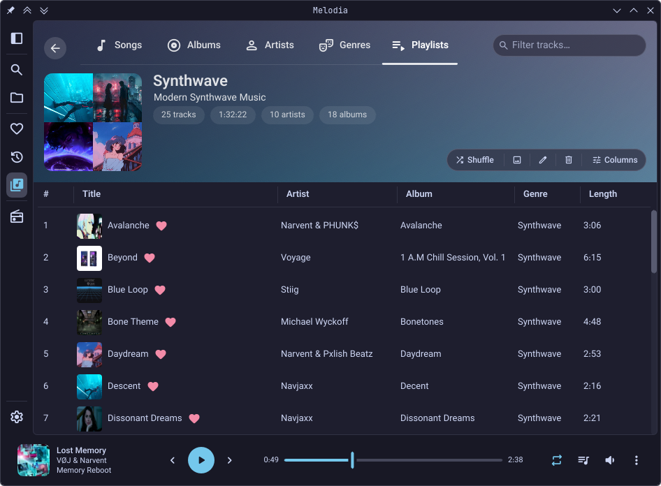</p>

---

## Highlights

- **Bit-perfect exclusive output** on Linux and Windows, with a Signal Path panel that grades every stage from the file to the device
- **Gapless playback and crossfade**, a 10-band equalizer, ReplayGain, and playback speed from 0.25× to 2.0×
- **Timed lyrics** from `.lrc` files, tags, or an opt-in online lookup, romanized for around a hundred scripts
- **Internet radio** from a worldwide directory or your own stream URLs, off until you switch it on
- **Six theme families** in light and dark, and Material You colors drawn from the playing artwork
- **A library that keeps up**: parallel scanning, live folder watching, full-text search, smart playlists, and tag editing written back to the files
- **A responsive mini-player** the window collapses into as you shrink it
- **Last.fm and ListenBrainz scrobbling**, Discord Rich Presence, and the OS media controls
- **No embedded browser engine** under the UI, which keeps the memory footprint small ([Footprint](#footprint))
- **Sixteen languages**, switchable without a restart

## Installation

Linux (X11 and Wayland) and Windows, on both `x86_64` and `aarch64`. Take the latest build from the
[Releases page](https://github.com/KenanSalar/Melodia/releases).

| Format | Install |
|--------|---------|
| `.rpm` (Fedora/RHEL) | `sudo dnf install ./melodia-*.rpm` |
| `.deb` (Debian/Ubuntu) | `sudo apt install ./melodia-*.deb` |
| AppImage | `chmod +x melodia-*.AppImage && ./melodia-*.AppImage` |
| Tarball | Extract, then `./install-linux.sh`, which installs into `~/.local/share/Melodia` with no `sudo`, so the in-app updater can replace it |
| Windows | Run the installer |

Melodia updates itself in place, minisign-signed. Release artifacts also carry
build-provenance attestations, verifiable with:

```bash
gh attestation verify <file> --repo KenanSalar/Melodia
```

## Screenshots

The shots below are a handful of the themes, all on the default aurora backdrop; Themes under [Features](#features) lists the rest.

### Library

<table>
  <tr>
    <td width="50%">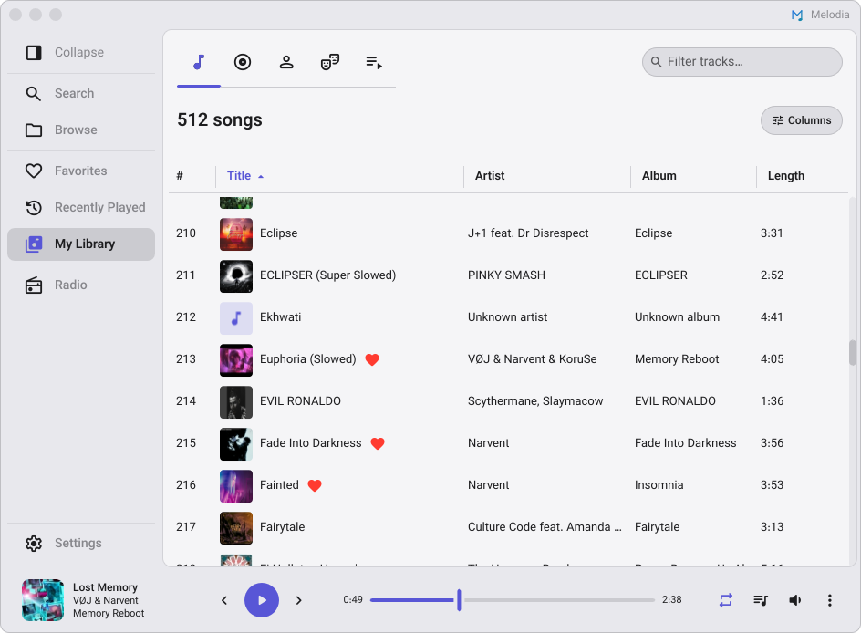<br><sub><b>My Library</b>: one page and five tabs, here on Songs with sortable, toggleable columns.</sub></td>
    <td width="50%">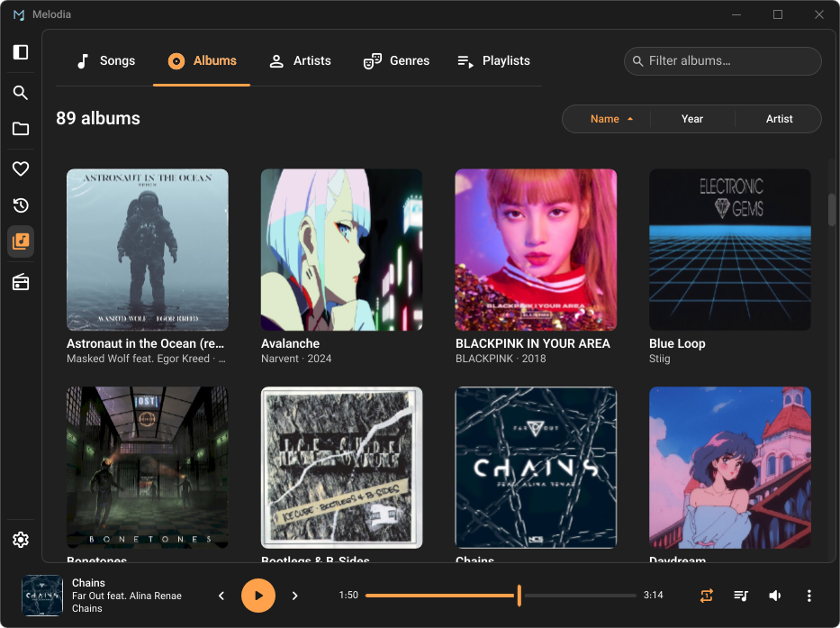<br><sub><b>Albums</b>: a virtualized cover grid, sorted by name, year, or artist.</sub></td>
  </tr>
  <tr>
    <td><br><sub><b>Detail in place</b>: opening a playlist grows the band into its banner, tabs still in reach.</sub></td>
    <td>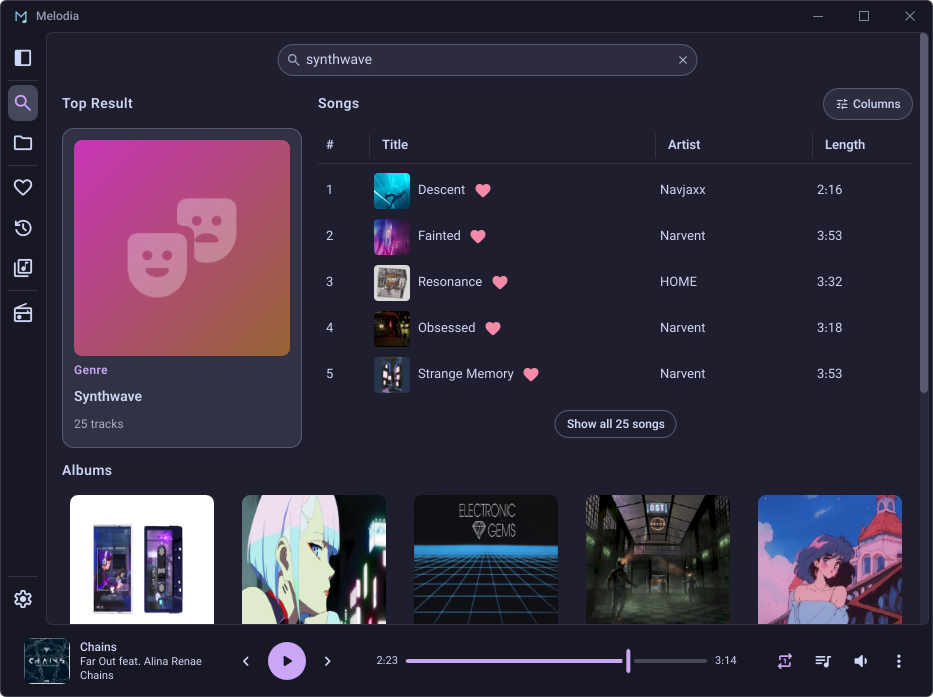<br><sub><b>Search</b>: a top-result card over songs, albums, artists, and genres.</sub></td>
  </tr>
</table>

### Now Playing

<table>
  <tr>
    <td width="50%">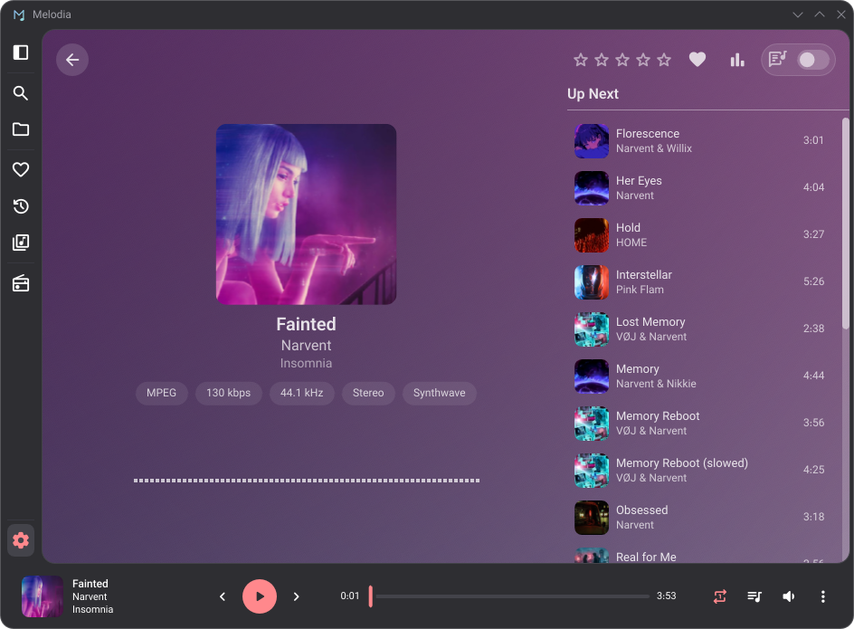<br><sub><b>Up Next</b>: the queue beside the artwork, the file's format, and the visualizer.</sub></td>
    <td width="50%">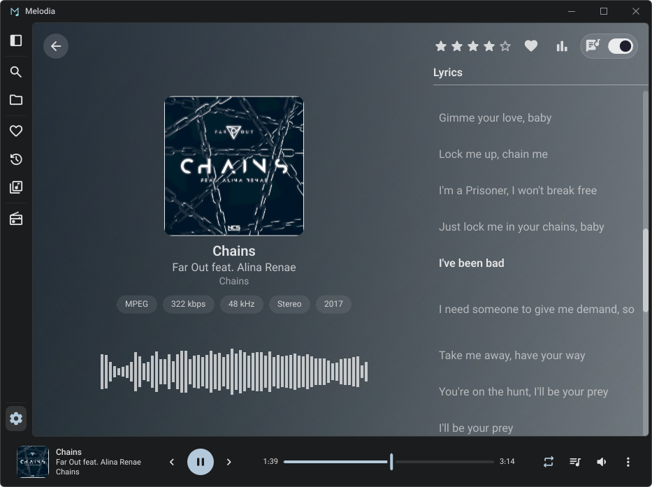<br><sub><b>Lyrics</b>: the header switch trades Up Next for a timed sheet that follows the song line by line.</sub></td>
  </tr>
</table>

### Internet Radio and Settings

<table>
  <tr>
    <td width="50%">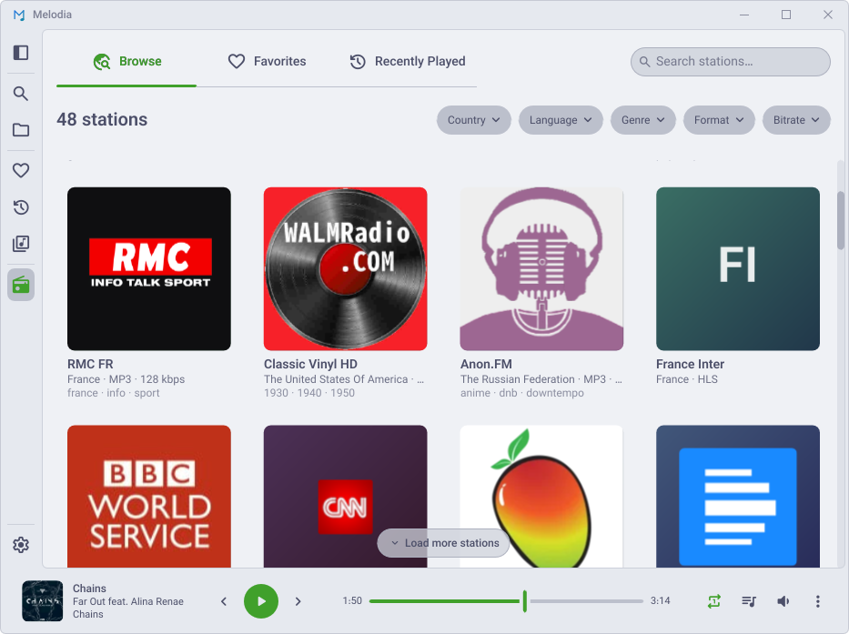<br><sub><b>Internet Radio</b>: a worldwide directory, narrowed by country, language, genre, codec, or bitrate. Off until you switch it on, under Settings ▸ Radio.</sub></td>
    <td width="50%">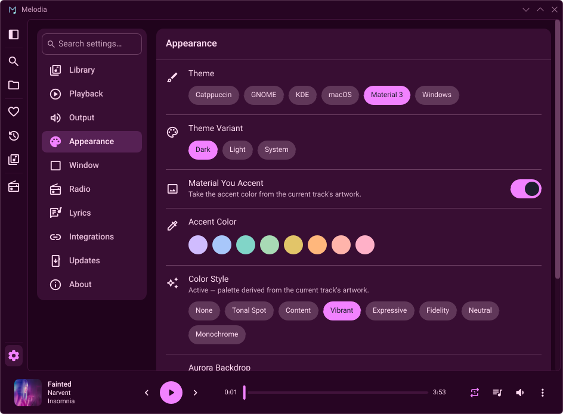<br><sub><b>Settings</b>: twelve categories beside the cards, searched all at once, here on the theme, variant, accent, and color style.</sub></td>
  </tr>
</table>

### Mini-player

Shrink the window and the full UI collapses into a mini-player that grows with it: a one-line strip, then a card, then a column with Up Next or lyrics below.

<table>
  <tr>
    <td width="50%" valign="top">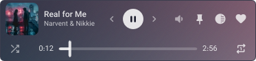<br><sub><b>Strip</b>: the most compact form, the controls on the title's line.</sub></td>
    <td width="50%" valign="top">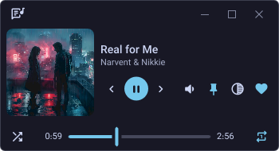<br><sub><b>Card</b>: the controls under the title beside larger artwork, the window buttons above.</sub></td>
  </tr>
  <tr>
    <td valign="top">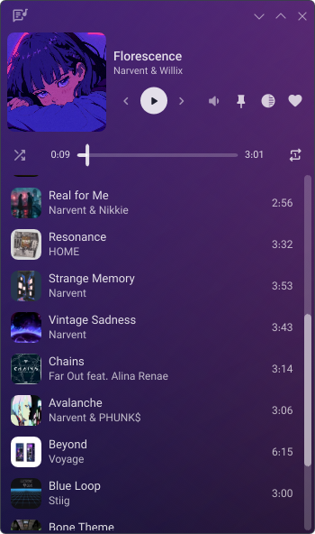<br><sub><b>Up Next</b>: taller still, the column opens the queue under the card.</sub></td>
    <td valign="top">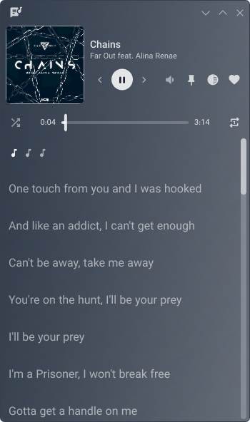<br><sub><b>Lyrics</b>: the switch in the corner trades Up Next for the timed sheet.</sub></td>
  </tr>
</table>

## Features

<details>
<summary><b>Library</b>: scanning, search, playlists, and tag editing</summary>

- A three-panel first-run card: add your Music folder or any other, pick the language, theme and accent, and see every feature that reaches the network before you switch it on. Settings ▸ About reopens it
- Parallel folder scanning, live folder watching, and incremental re-scans
- Content hashing (BLAKE3), so a moved or renamed file keeps its play counts, favorites, and place in the queue
- Full-text search (SQLite FTS5) over tracks, albums, artists, genres, and the people credited on a track: accent-insensitive, relevance-ranked, with a top-result card and recent history. Every list's filter box searches the same fields
- **My Library** gathers everything into one page with five tabs (Songs, Albums, Artists, Genres, Playlists); opening an entity grows the tab band into its banner rather than navigating away
- Favorites and Recently Played, each a hero banner over sortable lists and browsable card grids
- Browse by folder, as a detailed list or a grid of cards
- Star ratings, play and skip counts, natural sort, resizable and toggleable columns
- Multi-selection on every list and card grid: tick one to start, click to add, shift-click for a range, and right-click to queue, rate or tag the whole set. `Esc` clears it
- Copy from any right-click menu: a song's title, artist, album, "Artist - Title" or file path, an album's name, or a station's name, stream URL or website, one line per selected item
- Tag editing for one track or many, cover art included, written straight back to the files. Artists, genres and the ten studio credits are each an editable list, beside work and movement, key, mood, ISRC, label, catalog number, barcode and medium
- Manual and smart playlists, the latter rule-based and resolved live; `.m3u8` import and export, several at once as one `.zip` that imports back without extracting, drag-and-drop import, and reordering that moves a whole selection
- A database backup before every schema migration, three kept

</details>

<details>
<summary><b>Playback</b>: gapless, crossfade, EQ, the queue, and the mini-player</summary>

- Gapless, including the AAC encoder delay and padding read back from `iTunSMPB` or the MP4 edit list, and the trailing padding a Matroska file states
- Crossfade (1–12 s) across two decks with a clip-safe ramp, optionally skipped between same-album tracks, and under exclusive output too wherever the next track needs no change of device format
- 10-band equalizer (31 Hz – 16 kHz) with preamp, presets, and a soft-knee limiter, from the player bar's overflow menu or Settings ▸ Effects
- ReplayGain in track or album mode, with preamp and peak-based clip prevention, reached the same two ways
- A queue with shuffle and repeat in a resizable side panel, which floats over the page once the window is too narrow to dock it. Playing from any list queues that list behind your pick
- Drag tracks, albums, artists, genres, playlists, or files from your file manager into the queue or a playlist where you let go; a selection reorders together in the queue, Up Next, and the mini-player
- Hold Previous or Next to scan through a track in audible jumps that grow the longer you hold, and hold Play/Pause to stop
- Full-screen Now Playing with an up-next list and a spectrum, mirrored, or waveform visualizer tinted to the album's own colors
- Right-click the playing song in the player bar for the menu its row has in a list
- Playback speed 0.25×–2.0×, a playback-linked sleep timer, resume on startup, media keys
- Sample-rate conversion wherever a file's rate isn't the output's or the speed isn't 1×, band-limited or a CPU-light linear (the Windows default) under Settings ▸ Output. It carries across gapless track changes and is skipped where the rates already match
- A responsive mini-player that rearranges as you resize, from a one-line strip to a column with Up Next or lyrics, and reopens as the mini-player if you closed Melodia from it

</details>

<details>
<summary><b>Bit-perfect output</b>: exclusive ALSA and WASAPI output, graded stage by stage</summary>

- **Exclusive output** on Linux and Windows, off until you choose it under Settings ▸ Output. Each file's own sample rate and bit depth go straight to the device with no system mixer in between: an ALSA `hw:` device on Linux, asked of the sound server so it is handed back cleanly, and WASAPI exclusive mode on Windows
- A **Signal Path** panel grades every stage from the file to the device and sums it up as Bit-perfect, Enhanced (only effects you chose), Converted, Lossy, or Fallback (a refused claim). **Make Bit-Perfect** switches off whatever you chose that changes the sound
- A quality chip in the player bar carries that verdict and the device's rate under exclusive output, and opens the panel in one click
- **Output Device** (**Exclusive Device** on Linux) picks the sound card to claim, and on Windows routes shared output too. An unplugged device hands playback to the default and is taken back as soon as it returns
- A device that refuses the claim never costs you the music: playback carries on shared, and a notification and the panel say why
- **Unsupported Sample Rates** can resample a file to a rate the device has rather than give up the claim, staying gapless wherever the device's rate doesn't change
- Dither wherever samples Melodia changed are narrowed to 16 or 24 bits, while untouched samples still pass bit-exact
- **Hardware Volume** turns the device's own volume control instead of scaling the samples, so the slider keeps the sound bit-perfect and the system's volume keys move it too
- **Give the Device Back When Paused** hands the device to other apps after five minutes paused; pressing play takes it again
- A choosable buffer period, a short silence for DACs that mute while switching sample rates, and on Windows a polling mode for USB devices that stutter
- In shared mode on Linux, **Match the File's Sample Rate** reopens the device at each track's own rate wherever the sound server allows it
- Unplugging the device or restarting the sound server picks playback up on the new output at the same position

</details>

<details>
<summary><b>Lyrics</b>: timed sheets, an opt-in online lookup, and romanization</summary>

- A timed sheet in Now Playing, in place of Up Next, that follows the song line by line; click a line to seek to it. Switch it on from that view's header or Settings ▸ Lyrics
- **Off by default, and off means off**: while lyrics are switched off, nothing looks a sheet up or keeps one in memory
- Read from a `.lrc` beside the track or from the file's own lyrics tag, so a library that already carries them needs no online lookup
- **Online lookup is off until you switch it on**: nothing contacts **lrclib.net** until you do, and its answers are cached under your data folder rather than written into your files
- Romanization under a line in a script you don't read, around a hundred scripts in all, with engines matched to Korean and Japanese. On by default, and silent for a sheet already in Latin letters
- A bilingual sheet's translation is drawn under the words it glosses
- **Look up again** for a wrong match, **Save to file** to write the sheet into the track's tag, and **Edit lyrics…** to fix a stamp by hand

</details>

<details>
<summary><b>Internet Radio</b>: a worldwide directory and your own streams, off by default</summary>

- **Off until you switch it on**, under Settings ▸ Radio. Nothing contacts the directory until you do
- A worldwide directory (**radio-browser.info**, no account and no API key) narrowed by country, language, genre, codec, or bitrate
- Your own stream URLs, checked at the dialog rather than at the first click; `.pls`, `.m3u`, and `.asx` resolve to the audio behind them
- Live titles reach the player bar, Now Playing, your desktop's media controls, and Discord, with buffering and reconnection handled underneath
- Favorites, Recently Played, station pages, cached logos, and playlist-file import and export
- Station cards select like any other card, with a right-click menu to play, favorite, copy, edit, or remove them
- The titles a station announced this session, listed under it and copyable
- Segmented (HLS) stations play like any other

</details>

<details>
<summary><b>Themes</b>: six families in light and dark, and Material You</summary>

- Six families, each with light and dark variants and configurable accents: **Catppuccin** (Latte, Frappé, Macchiato, Mocha), **Material 3**, **GNOME Adwaita**, **KDE Breeze**, **Windows Fluent**, and **macOS**
- System dark/light is followed automatically and KDE color schemes are read from `kdeglobals`. A first launch starts on the desktop's own theme (Windows Fluent, KDE Breeze, or GNOME Adwaita, in the system's light or dark mode), and on Catppuccin Mocha anywhere else
- Material You derives a palette from the current artwork in seven color styles, fading the window into each new cover's colors, and the accent and window outline can follow the artwork too. Material 3 and Material You follow Google's 2025 Material color spec wherever it defines the style
- Headers paint an aurora of the album's own colors by default, or a blurred cover instead
- A custom transparent titlebar, or native decorations, which KDE opens on

</details>

<details>
<summary><b>Formats and languages</b>: MP3, FLAC, AAC, ALAC, Opus, and more, in sixteen locales</summary>

MP3, FLAC, M4A/M4B (AAC and ALAC), raw AAC (`.aac`), Ogg Vorbis (`.ogg`, `.oga`), Opus (`.opus`, up to 7.1), WAV (PCM and ADPCM), AIFF/AIFF-C, Matroska (`.mka`), and CAF. Matroska and CAF carry no tags Melodia can read, so those tracks list under their filename, as does anything whose tags are too damaged to parse.

Sixteen locales (English, German, French, Spanish, Turkish, Greek, Italian, Brazilian Portuguese, European Portuguese, Dutch, Polish, Indonesian, Russian, Ukrainian, Hungarian, Vietnamese), switchable at runtime with no restart under Settings ▸ Language.

</details>

<details>
<summary><b>System integration</b>: scrobbling, Discord, media controls, the tray, and updates</summary>

- Scrobbling to **Last.fm** and **ListenBrainz**, each independently, with loved-track sync that catches your existing favorites up on connect, and a durable offline queue. A ListenBrainz love needs the track's MusicBrainz recording ID in its tags
- **Discord Rich Presence** (off by default): title, artist, album, and optionally a cover looked up on Deezer, sent to your running Discord client. Nothing leaves the machine while it is off
- OS media controls (MPRIS2 on Linux, SMTC on Windows) and media keys
- A system-tray icon with playback controls, on by default, and an optional close-to-tray; both under Settings ▸ Window
- A daily update check, named on first run and switchable under Settings ▸ Updates. It asks GitHub for a signed manifest and nothing else; package-managed installs skip it entirely
- Set Melodia as your default player and double-click a track; it runs as a single instance, so files open in the window you already have
- Always-on-top on Windows, on any X11 desktop, and on Wayland under KDE, or GNOME with the Window Calls extension
- On Linux, a self-deploying desktop entry and AppStream metadata for KDE Discover and GNOME Software
- Window, queue, and navigation state persisted across sessions

</details>

## Footprint

Release builds on one dual-boot PC, a Ryzen 7 9800X3D (8 cores, 16 threads) with an RTX 3080 and the window on a 144 Hz display. Melodia opened on a playlist's detail view, the visualizer in the Mirrored style, and each scenario is sampled every second for 60 s: memory is the median sample, CPU and GPU the total over that minute. With a 512-track library, the native titlebar, and each platform's default sample-rate conversion:

| Scenario | Linux, Anonymous | Linux, CPU (1 core) | Windows, Commit | Windows, CPU (1 core) |
| --- | --- | --- | --- | --- |
| Idle | 29.44 MiB | 0.08% | 109.62 MiB | 0.16% |
| Playing, list view | 30.05 MiB | 0.60% | 112.26 MiB | 0.78% |
| Playing, visualizer live | 31.50 MiB | 2.42% | 118.77 MiB | 7.19% |

Each platform's figure is what its own kernel accounts for, so the two memory columns don't compare with each other. The full tables add startup, the Songs tab, the whole library queued, the custom titlebar, and a second library of 50,500 tracks beside the first, 51,012 in all.

<details>
<summary><b>Linux (Fedora)</b>: every scenario, both titlebars, both libraries</summary>

Measured with [`scripts/measure-footprint.py`](scripts/measure-footprint.py) on KDE Plasma under Wayland, with the default Band-Limited sample-rate conversion. Startup is sampled from the moment Melodia launches, and every other scenario starts 150 s after the launch or the switch into it, once the database connections either opened have closed. The Songs tab is My Library ▸ Songs, opened with the playlist still playing; double-clicking its first track queues the whole library, and the queue sheet opens over that queue.

#### Native titlebar

| Scenario | Anonymous | PSS | USS | RSS | GPU memory | CPU (1 core) | CPU (all cores) | GPU |
| --- | --- | --- | --- | --- | --- | --- | --- | --- |
| Startup | 29.75 MiB | 87.78 MiB | 80.97 MiB | 163.77 MiB | 28.00 MiB | 0.90% | 0.06% | 0.03% |
| Idle | 29.44 MiB | 84.43 MiB | 80.25 MiB | 155.06 MiB | 28.00 MiB | 0.08% | 0.01% | 0.00% |
| Playing, list view | 30.05 MiB | 86.01 MiB | 81.77 MiB | 156.57 MiB | 24.00 MiB | 0.60% | 0.04% | 0.00% |
| Playing, visualizer live | 31.50 MiB | 90.25 MiB | 86.08 MiB | 160.95 MiB | 27.00 MiB | 2.42% | 0.15% | 1.78% |
| Playing, Songs tab open | 33.70 MiB | 92.68 MiB | 88.53 MiB | 163.39 MiB | 24.00 MiB | 0.58% | 0.04% | 0.36% |
| Playing, whole library queued | 33.66 MiB | 92.86 MiB | 88.68 MiB | 163.55 MiB | 25.00 MiB | 0.48% | 0.03% | 0.00% |
| Playing, queue sheet open | 35.20 MiB | 94.45 MiB | 90.27 MiB | 165.14 MiB | 27.00 MiB | 0.57% | 0.04% | 0.00% |

With both libraries, 51,012 tracks. The higher PSS and RSS at startup are the library's database, which every connection that read it keeps mapped until it closes; RSS counts it once per connection.

| Scenario | Anonymous | PSS | USS | RSS | GPU memory | CPU (1 core) | CPU (all cores) | GPU |
| --- | --- | --- | --- | --- | --- | --- | --- | --- |
| Startup | 36.62 MiB | 153.39 MiB | 87.55 MiB | 408.13 MiB | 28.00 MiB | 2.10% | 0.13% | 0.00% |
| Idle | 35.48 MiB | 90.61 MiB | 86.38 MiB | 161.28 MiB | 28.00 MiB | 0.08% | 0.01% | 0.00% |
| Playing, list view | 36.24 MiB | 92.27 MiB | 88.10 MiB | 163.00 MiB | 24.00 MiB | 0.55% | 0.03% | 0.00% |
| Playing, visualizer live | 37.14 MiB | 95.98 MiB | 91.80 MiB | 166.77 MiB | 27.00 MiB | 2.52% | 0.16% | 2.37% |
| Playing, Songs tab open | 40.51 MiB | 99.60 MiB | 95.42 MiB | 170.39 MiB | 24.00 MiB | 0.57% | 0.04% | 0.00% |
| Playing, whole library queued | 42.22 MiB | 101.55 MiB | 97.38 MiB | 172.34 MiB | 25.00 MiB | 0.50% | 0.03% | 0.00% |
| Playing, queue sheet open | 43.05 MiB | 102.45 MiB | 98.27 MiB | 173.24 MiB | 27.00 MiB | 0.58% | 0.04% | 0.02% |

#### Custom titlebar

| Scenario | Anonymous | PSS | USS | RSS | GPU memory | CPU (1 core) | CPU (all cores) | GPU |
| --- | --- | --- | --- | --- | --- | --- | --- | --- |
| Startup | 30.39 MiB | 91.13 MiB | 84.30 MiB | 167.70 MiB | 32.00 MiB | 0.98% | 0.06% | 0.05% |
| Idle | 29.75 MiB | 87.48 MiB | 83.19 MiB | 158.34 MiB | 32.00 MiB | 0.10% | 0.01% | 0.00% |
| Playing, list view | 30.59 MiB | 89.35 MiB | 85.06 MiB | 160.21 MiB | 29.00 MiB | 0.53% | 0.03% | 0.00% |
| Playing, visualizer live | 31.55 MiB | 91.06 MiB | 86.84 MiB | 161.99 MiB | 32.00 MiB | 2.75% | 0.17% | 1.93% |
| Playing, Songs tab open | 34.57 MiB | 94.07 MiB | 89.85 MiB | 165.00 MiB | 32.00 MiB | 0.87% | 0.05% | 1.09% |
| Playing, whole library queued | 34.38 MiB | 94.08 MiB | 89.86 MiB | 165.01 MiB | 32.00 MiB | 0.50% | 0.03% | 0.00% |
| Playing, queue sheet open | 34.82 MiB | 94.57 MiB | 90.35 MiB | 165.50 MiB | 34.00 MiB | 0.58% | 0.04% | 0.00% |

With both libraries, 51,012 tracks:

| Scenario | Anonymous | PSS | USS | RSS | GPU memory | CPU (1 core) | CPU (all cores) | GPU |
| --- | --- | --- | --- | --- | --- | --- | --- | --- |
| Startup | 39.32 MiB | 158.84 MiB | 92.72 MiB | 352.93 MiB | 32.00 MiB | 2.23% | 0.14% | 0.03% |
| Idle | 37.89 MiB | 95.66 MiB | 91.26 MiB | 166.68 MiB | 32.00 MiB | 0.03% | 0.00% | 0.00% |
| Playing, list view | 38.82 MiB | 97.62 MiB | 93.23 MiB | 168.64 MiB | 29.00 MiB | 0.60% | 0.04% | 0.00% |
| Playing, visualizer live | 38.79 MiB | 98.21 MiB | 93.82 MiB | 169.23 MiB | 32.00 MiB | 3.42% | 0.21% | 4.17% |
| Playing, Songs tab open | 41.17 MiB | 100.65 MiB | 96.26 MiB | 171.67 MiB | 29.00 MiB | 0.68% | 0.04% | 0.00% |
| Playing, whole library queued | 42.46 MiB | 101.98 MiB | 97.68 MiB | 173.09 MiB | 30.00 MiB | 0.52% | 0.03% | 0.00% |
| Playing, queue sheet open | 42.80 MiB | 102.37 MiB | 98.08 MiB | 173.50 MiB | 32.00 MiB | 0.58% | 0.04% | 0.00% |

Linux keeps no commit charge per process, so **Anonymous** is the figure to compare: the memory Melodia allocated itself, in RAM or in swap, which nothing another process does can move. **PSS** is KDE System Monitor's Memory column. It adds a share of the file-backed pages, mostly the binary and the shared graphics stack rather than anything Melodia allocated, and that share shrinks whenever another program maps the same libraries. **USS** is the part no other process maps, what closing Melodia gives back, and System Monitor's Private column. **RSS** counts every shared page in full. **GPU memory** is the video memory the NVIDIA driver charges to Melodia, where FemtoVG keeps its textures and framebuffers, counted apart from the rest. **CPU (1 core)** counts one full core as 100%, and **CPU (all cores)** spreads that across all 16 threads, as System Monitor's CPU column does. **GPU** is the utilization the NVIDIA driver reports for Melodia, in whole percents each second.

</details>

<details>
<summary><b>Windows</b>: every scenario, both titlebars, both libraries</summary>

Measured with [`scripts/measure-footprint.py`](scripts/measure-footprint.py), on an output device Windows mixes at 192 kHz, so every track passes through the sample-rate conversion. Startup is sampled from the moment Melodia launches, and every other scenario starts 150 s after the launch or the switch into it, once the database connections either opened have closed. The Songs tab is My Library ▸ Songs, opened with the playlist still playing; double-clicking its first track queues the whole library, and the queue sheet opens over that queue.

#### Native titlebar

| Scenario | Commit | Private WS | Working set | GPU dedicated | GPU shared | CPU (1 core) | CPU (all cores) | GPU |
| --- | --- | --- | --- | --- | --- | --- | --- | --- |
| Startup | 113.70 MiB | 64.12 MiB | 121.79 MiB | 27.95 MiB | 23.60 MiB | 0.81% | 0.05% | 0.07% |
| Idle | 109.62 MiB | 62.80 MiB | 119.55 MiB | 24.63 MiB | 23.60 MiB | 0.16% | 0.01% | 0.00% |
| Playing, list view | 112.26 MiB | 64.05 MiB | 121.41 MiB | 24.63 MiB | 23.60 MiB | 0.78% | 0.05% | 0.04% |
| Playing, visualizer live | 118.77 MiB | 68.34 MiB | 126.37 MiB | 25.56 MiB | 25.60 MiB | 7.19% | 0.45% | 1.83% |
| Playing, Songs tab open | 120.30 MiB | 71.42 MiB | 128.80 MiB | 24.86 MiB | 25.60 MiB | 0.76% | 0.05% | 0.02% |
| Playing, whole library queued | 121.39 MiB | 71.83 MiB | 129.36 MiB | 25.00 MiB | 25.60 MiB | 0.76% | 0.05% | 0.02% |
| Playing, queue sheet open | 126.84 MiB | 73.21 MiB | 130.87 MiB | 27.68 MiB | 25.60 MiB | 0.83% | 0.05% | 0.05% |

With both libraries, 51,012 tracks. The higher commit and working set at startup are the library's database: every connection that read it holds a page cache of its own, which commit counts, and maps the file, which the working set counts, until it closes.

| Scenario | Commit | Private WS | Working set | GPU dedicated | GPU shared | CPU (1 core) | CPU (all cores) | GPU |
| --- | --- | --- | --- | --- | --- | --- | --- | --- |
| Startup | 154.54 MiB | 99.58 MiB | 322.75 MiB | 27.95 MiB | 23.60 MiB | 6.09% | 0.38% | 0.07% |
| Idle | 129.06 MiB | 79.05 MiB | 135.74 MiB | 24.64 MiB | 23.60 MiB | 0.29% | 0.02% | 0.00% |
| Playing, list view | 131.95 MiB | 80.70 MiB | 138.11 MiB | 24.64 MiB | 23.60 MiB | 0.99% | 0.06% | 0.05% |
| Playing, visualizer live | 139.31 MiB | 86.05 MiB | 144.10 MiB | 25.57 MiB | 25.61 MiB | 7.76% | 0.49% | 1.03% |
| Playing, Songs tab open | 143.68 MiB | 89.84 MiB | 147.27 MiB | 24.86 MiB | 25.61 MiB | 0.86% | 0.05% | 0.04% |
| Playing, whole library queued | 145.32 MiB | 92.79 MiB | 150.37 MiB | 25.00 MiB | 25.61 MiB | 0.47% | 0.03% | 0.03% |
| Playing, queue sheet open | 150.29 MiB | 93.70 MiB | 151.41 MiB | 27.69 MiB | 25.61 MiB | 0.83% | 0.05% | 0.05% |

Both tables use the default Linear sample-rate conversion. Band-Limited costs more CPU while playing: with the 512-track library, about 1.9% of one core in the list view and about 7.9% with the visualizer live.

#### Custom titlebar

| Scenario | Commit | Private WS | Working set | GPU dedicated | GPU shared | CPU (1 core) | CPU (all cores) | GPU |
| --- | --- | --- | --- | --- | --- | --- | --- | --- |
| Startup | 119.58 MiB | 64.43 MiB | 122.53 MiB | 33.64 MiB | 23.72 MiB | 1.17% | 0.07% | 0.09% |
| Idle | 111.93 MiB | 62.23 MiB | 119.05 MiB | 27.94 MiB | 23.72 MiB | 0.18% | 0.01% | 0.00% |
| Playing, list view | 114.52 MiB | 64.11 MiB | 121.56 MiB | 27.94 MiB | 23.72 MiB | 0.89% | 0.06% | 0.05% |
| Playing, visualizer live | 121.69 MiB | 67.92 MiB | 126.04 MiB | 29.36 MiB | 25.73 MiB | 6.22% | 0.39% | 0.99% |
| Playing, Songs tab open | 122.33 MiB | 70.48 MiB | 127.95 MiB | 28.68 MiB | 25.73 MiB | 0.62% | 0.04% | 0.05% |
| Playing, whole library queued | 123.60 MiB | 71.45 MiB | 129.04 MiB | 28.82 MiB | 25.73 MiB | 0.76% | 0.05% | 0.05% |
| Playing, queue sheet open | 128.21 MiB | 73.15 MiB | 130.89 MiB | 31.50 MiB | 25.73 MiB | 0.81% | 0.05% | 0.07% |

With both libraries, 51,012 tracks:

| Scenario | Commit | Private WS | Working set | GPU dedicated | GPU shared | CPU (1 core) | CPU (all cores) | GPU |
| --- | --- | --- | --- | --- | --- | --- | --- | --- |
| Startup | 158.59 MiB | 104.32 MiB | 308.81 MiB | 33.64 MiB | 23.72 MiB | 4.92% | 0.31% | 0.07% |
| Idle | 130.45 MiB | 82.16 MiB | 153.18 MiB | 27.94 MiB | 23.72 MiB | 0.23% | 0.01% | 0.00% |
| Playing, list view | 133.77 MiB | 84.41 MiB | 155.91 MiB | 27.94 MiB | 23.72 MiB | 0.60% | 0.04% | 0.08% |
| Playing, visualizer live | 138.98 MiB | 87.27 MiB | 159.16 MiB | 29.36 MiB | 25.73 MiB | 5.99% | 0.37% | 1.57% |
| Playing, Songs tab open | 144.77 MiB | 95.09 MiB | 166.25 MiB | 28.68 MiB | 25.73 MiB | 1.09% | 0.07% | 0.05% |
| Playing, whole library queued | 146.41 MiB | 96.29 MiB | 167.59 MiB | 28.82 MiB | 25.73 MiB | 0.47% | 0.03% | 0.05% |
| Playing, queue sheet open | 151.18 MiB | 97.63 MiB | 169.06 MiB | 31.49 MiB | 25.73 MiB | 0.70% | 0.04% | 0.08% |

Both tables use the default Linear sample-rate conversion. Band-Limited costs more CPU while playing: with the 512-track library, about 2.1% of one core in the list view and about 6.2% with the visualizer live.

Windows keeps no PSS, so **Commit** is the figure to compare: the private memory Windows has set aside for Melodia, in RAM or paged out, which doesn't fall when Windows trims the process. **Private WS** is Task Manager's Memory column, the private memory in RAM at that moment. **Working set** adds the pages Melodia shares with other processes, mostly system DLLs. **GPU dedicated** and **GPU shared** are the video memory Task Manager lists per process, where FemtoVG keeps its textures and framebuffers, counted apart from commit. **CPU (1 core)** counts one full core as 100%, and **CPU (all cores)** spreads that across all 16 threads, as Task Manager's Details tab does. **GPU** is the busiest GPU engine, Task Manager's per-process figure.

</details>

## Keyboard Shortcuts

`Space`, the arrow keys and single letters cover playback, the queue and navigation, and the OS media keys (play/pause, next, previous, stop) are handled too. Stop takes the track back to its start, as holding the Play/Pause button does.

<details>
<summary>All shortcuts</summary>

| Action | Shortcut |
|--------|----------|
| Play / Pause | `Space` |
| Seek backward / forward 5s | `←` / `→` |
| Seek backward / forward 30s | `Shift+←` / `Shift+→` |
| Previous / Next track | `Ctrl+←` / `Ctrl+→`, or `P` / `N` |
| Volume up / down 5% | `↑` / `↓`, or the mouse wheel over the volume control |
| Volume up / down 1% | `Ctrl+↑` / `Ctrl+↓`, or `Ctrl`+wheel over the volume control |
| Seek to 0–90% | `0`–`9` |
| Mute | `M` |
| Favorite current track | `L` |
| Shuffle | `S` |
| Repeat mode | `R` |
| Queue panel | `Q` |
| Select all in the queue, after clicking it | `Ctrl+A` |
| Remove the queue's selected tracks, after clicking it | `Delete` or `Backspace` |
| Now Playing view | `F` |
| Maximize | `F11` |
| Toggle sidebar | `Ctrl+B` |
| Settings | `Ctrl+,` |
| New playlist | `Ctrl+N` |
| Close dialog / close Now Playing or the queue overlay / clear selection | `Esc` |
| Navigate back / forward through history | `Mouse-4` / `Mouse-5` |

</details>

## Building from Source

[Rust](https://rustup.rs/) **1.97.0**, edition 2024, pinned by `rust-toolchain.toml` and installed by
rustup on its own. Linux additionally needs the development packages for Slint's FemtoVG renderer
(no WebKitGTK); Windows needs nothing extra.

```bash
# Debian/Ubuntu
sudo apt install libfontconfig1-dev libfreetype6-dev libasound2-dev \
                 libxkbcommon-dev mesa-vulkan-drivers libwayland-dev

# Fedora
sudo dnf install fontconfig-devel freetype-devel alsa-lib-devel \
                 libxkbcommon-devel vulkan-loader wayland-devel
```

```bash
git clone https://github.com/KenanSalar/Melodia.git
cd Melodia

cargo run -p melodia                                     # debug build, runs the app
cargo build --release -p melodia                         # release → target/release/Melodia
cargo clippy --all-targets --workspace -- -D warnings    # lint
cargo test --workspace                                   # tests
```

<details>
<summary>Build notes: the dev data folder, the vendored winit, and API keys</summary>

A source build keeps its own library under `Melodia-dev`, beside an installed copy's folder rather
than inside it, so a schema migration still on a branch can't leave an installed Melodia unable to
open its database, and the two can run at once. `MELODIA_DATA_DIR` points either build at a
directory of your choosing.

`winit/` is a checked-in copy of winit 0.30.13 plus an unmerged Wayland file drag-and-drop fix
([winit#1881]) and drag events that say where the pointer is, which is how a dropped file finds
the queue or the open playlist. It is wired by `Cargo.toml`'s `[patch.crates-io]`, so a fresh clone
builds with no setup.

Last.fm scrobbling needs an [API application](https://www.last.fm/api/account/create)'s key and
shared secret, which identify the app rather than any account. They are read at compile time from
`LASTFM_API_KEY` / `LASTFM_SHARED_SECRET`, so nothing secret lives in the repo; for local builds,
copy `.env.example` to `.env` and `build.rs` bakes them in. A build without them is fully
functional, ListenBrainz included, and the Last.fm Connect button reports "not configured in this
build". A fork wanting its own Discord presence sets `MELODIA_DISCORD_APP_ID`.

[winit#1881]: https://github.com/rust-windowing/winit/issues/1881

</details>

## Architecture

The Slint UI runs on the main thread and a single multi-threaded Tokio runtime handles the database,
scanner, watcher, player control, and HTTP. There is no WebView and no IPC boundary: UI callbacks
spawn async work, state flows back over `watch` and `mpsc` channels consumed by UI-thread tasks, and
cpal's device callback, or an exclusive claim's own writer thread, pulls the mixer directly, so
decoding, the DSP chain, and the mix stay off the runtime entirely.

Fourteen crates, layered so the compiler enforces the direction rather than a convention: the UI
names no database or socket, the decoders name no mixer, the tag writer names no state machine.
Slint 1.18 on FemtoVG, Tokio, Symphonia and cpal (with ALSA and WASAPI directly for exclusive output),
SQLite via SQLx with WAL and FTS5, Lofty for tags, Rayon, BLAKE3, and minisign for the updater.

The doc comments are the architecture reference, [`CLAUDE.md`](CLAUDE.md) holds the repo-wide
rules and commands for a coding agent, and [`docs/adr/`](docs/adr/) records why each piece was
chosen over the alternatives.

## Data and Logs

Everything lives under the OS application-data directory, `~/.local/share/Melodia` on Linux and
`%APPDATA%\Melodia` on Windows, and `MELODIA_DATA_DIR` moves the whole folder somewhere else.

<details>
<summary>What the folder holds</summary>

| File / folder | Purpose |
|---------------|---------|
| `melodia.db` | The music library (SQLite, WAL + FTS5) |
| `settings.json`, `views.json`, `queue.json` | Preferences, per-view UI state, and the queue with the station tuned over it |
| `scrobble_*.json` | Last.fm session key and ListenBrainz token (`0600` on Unix), plus the offline queue |
| `artwork/`, `artists/`, `radio-logos/` | Cached album, artist, and station images. A deleted cover is put back from your music files on the next scan |
| `lyrics/` | Sheets the online lookup found, and a marker for the tracks it found none for |
| `backups/` | Database copies taken before each schema migration |
| `logs/` | Rolling logs and crash reports |

</details>

Melodia writes a log on every run, with no environment variable and no terminal needed, and leaves a
crash report beside it if it ever panics. The current log is `melodia_rCURRENT.log`; it rotates at
2 MiB and keeps the 7 most recent, so `logs/` stays under about 16 MiB.

**Settings → About → Diagnostics** opens that folder, saves a single `melodia-diagnostics-*.txt` to
attach to a bug report, and toggles verbose logging. The report carries your version, OS, desktop
session and install method, your library's size, a short fixed list of settings, recent crash
reports, and the tail of the logs. Home directory paths are shortened to `~`, and **no credentials,
tokens or session keys are ever included**; those live in a separate file the report doesn't read.

If Melodia won't start at all, `melodia --logs` prints the log directory and exits. That covers Linux
and macOS: a Windows build runs with no console attached, so use `%APPDATA%\Melodia\logs\` directly.
For finer control than the verbose switch, `RUST_LOG=debug melodia` overrides the filter for both the
log file and the terminal.

## Contributing and Support

Contributions are welcome. [`CONTRIBUTING.md`](CONTRIBUTING.md) has the setup, the checks to run
before pushing, and how pull requests are handled.

Melodia is free, open source, and built in my spare time, with nothing gated behind payment. If it's
useful to you, you can support me on [GitHub Sponsors](https://github.com/sponsors/KenanSalar) or
[Ko-fi](https://ko-fi.com/kenansalar), the same two links the app carries at **Settings → About**.

## License

Copyright (C) 2026 Kenan Salar. Melodia is free software under the
[GNU Affero General Public License](LICENSE), version 3 or, at your option, any later version, and is
distributed without any warranty.

The AGPL covers Melodia itself. Two fonts, a patched winit fork and several crates on copyleft terms
(the UI toolkit, the audio decoders and the Japanese romanization engine) are compiled into the
binary under their own terms; every one of those licenses ships in [`licenses/`](licenses/), which
every package carries alongside this file.

## Acknowledgments

Built on the work of the [Slint](https://slint.dev/),
[cpal](https://github.com/RustAudio/cpal),
[Symphonia](https://github.com/pdeljanov/Symphonia), and
[SQLx](https://github.com/launchbadge/sqlx) projects, the
[Catppuccin](https://catppuccin.com/) palette, and
[Material Foundation](https://m3.material.io/)'s color utilities, along with the many other crates
listed in `Cargo.toml`. The station directory is [radio-browser.info](https://www.radio-browser.info)
(CC0 data, no account), and the lyrics directory is [LRCLIB](https://lrclib.net) (also no account).
Romanization is [uroman-rs](https://github.com/stellanomia/uroman-rs) for most scripts and
[kakasi](https://github.com/Theta-Dev/kakasi) for Japanese.

Melodia's interface is set in [Vazirmatn](https://github.com/rastikerdar/vazirmatn) (SIL Open Font
License 1.1), with its Greek, Russian, Ukrainian and Vietnamese letters taken from
[Roboto](https://github.com/googlefonts/roboto-3-classic) (Apache License 2.0), and draws its icons
from [Material Symbols Rounded](https://github.com/google/material-design-icons) (Apache License
2.0). All three are modified, as is the vendored [winit](https://github.com/rust-windowing/winit) fork
(Apache License 2.0) that gives Wayland its drag-and-drop events and says where a drag is on every
platform Melodia ships for. What changed in each ships in
[`licenses/`](licenses/).
